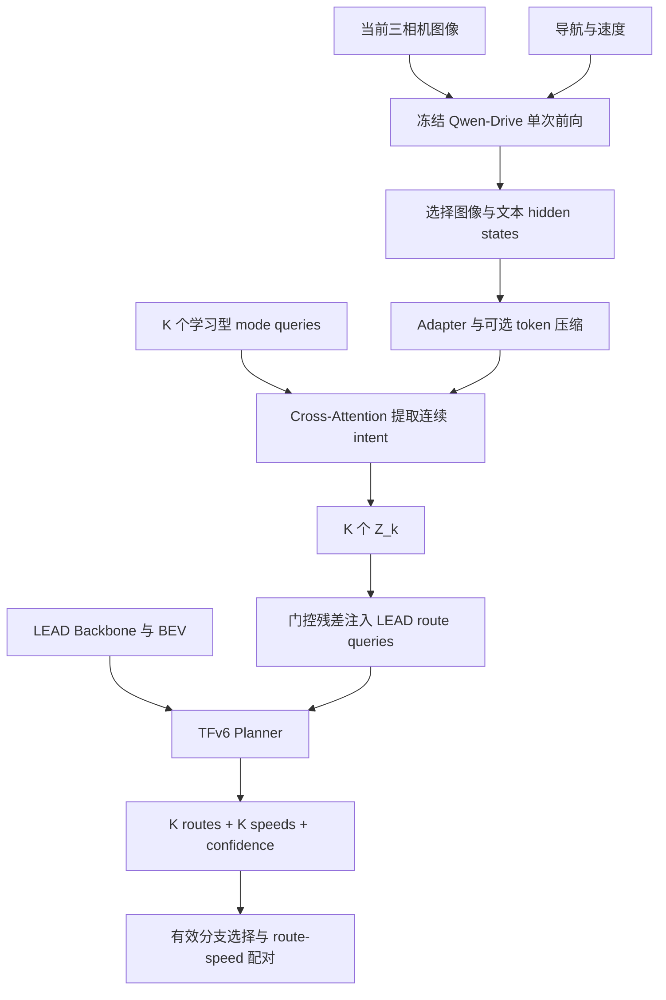

# 基于 Qwen-Drive Hidden State 的连续 Visual Intent 与 LEAD Planner 融合方案

> 状态：研究设计，尚未实现或验证性能。参考代码：`master-skd/lead` 的 `visual-intent-p2`，检查提交 `15e9fb85a2d9c6761a418e5ae4abe8e3173f0f8f`。项目仍以训练与开环验证为主要阶段，闭环相关内容属于后续计划。
>
> 目标：每帧执行一次冻结 Qwen-Drive 前向，从 hidden states 提取 K 个连续 intent 条件化 LEAD 多路径 Planner；评测时不进行逐 token 自回归生成，也不依赖 corridor 热力图、阈值、骨架或 anchor 提取。

## 1. 背景与研究问题

旧路径将 Qwen-VL hidden state 解码为 CARLA corridor 热力图，再经阈值、骨架提取、anchor 和 MLP 注入路线 query。该过程存在多级启发式与信息压缩，且依赖 corridor 标签。当前 P7 使用冻结 Qwen-Drive 两阶段自回归文本生成：先分析场景，再生成结构化 JSON，经离散语义编码后条件化 Planner。这条链路可解释，但评测时逐帧两轮生成代价高，用户观察到单条 route 超过 20 小时；这个数字是当前环境的观测，不代表各方案的基准测试。

研究问题：**Qwen-Drive 的连续场景表示，是否能在每帧单次前向的预算下，为 LEAD 提供有效的多分支驾驶条件？进一步，离线 AR 输出能否作为训练期教师，改善快速版本？**

- 隐状态方案使用驾驶 VLM 的表征，并非推理时使用了自回归生成或其生成的推理链。
- 隐状态容量更大不代表保留了全部有用信息，也不保证 Planner 会使用 intent；需要通过受控消融验证。
- Qwen-Drive AR 教师可以离线生成；教师输出是有噪声的伪标签，不是交通真值。
- 保留 LEAD BEV、导航、K route + K speed、route confidence 及现有 route/speed 控制接口。代码中 P7 目前为配对速度；与旧设计中共享速度的默认值不同。
- 使用 K 个学习型 mode queries 是本方案的明确变更，与旧 P7 文档中“不增加 K 个学习型 Intent Queries”的约束不同；如该约束必须保留，使用第 5 节替代方案。

## 2. 推荐架构与数据流



每次 Planner 前向所用的 Qwen 特征必须标记为当前输入帧；任何异步优化都需要校验帧 ID 与时间戳，不可静默使用未来信息或过期特征。此方案首先评估逐帧同步处理，不预设性能或实时性。

### 2.1 冻结 Qwen-Drive 单次前向

输入：三相机图像、简短固定任务提示、导航命令和车速。可先使用：

```text
Understand the driving scene for route planning.
Navigation: {command}. Ego speed: {speed} m/s.
```

仅执行 VLM forward：

\[
H^{Q}=\operatorname{QwenDriveForward}(I_t,c_t,v_t)\in\mathbb{R}^{B\times L\times D_Q}.
\]

`eval()` + `torch.inference_mode()`，不调用文本 `generate`，不加载已训练的 Planning Expert 来参与此方案。以官方 processor 为准，确认实际 Qwen-Drive 代码的图像预处理、视角顺序、token layout、hidden size、模型层、padding 和 device；不能沿用旧 Qwen3-VL 的固定尺寸假设。导航与速度写入 prompt 并不代表任意位置的图像 token 均融合了后续文本信息：必须检查输入顺序与实际注意力机制；如需导航条件，保留能读取导航信息的文本 token，或在 adapter 中显式注入导航/速度。

### 2.2 Adapter 与 token 压缩

\[
H^I=\operatorname{Adapter}(\operatorname{Select}(H^{Q}))\in\mathbb{R}^{B\times M\times D}.
\]

`Select` 保留所需的图像 token 和可选文本 token，维护每个视角与 padding mask；adapter 进行维度映射、归一化，必要时压缩 token。先测真实 token 数和耗时，再比较不压缩与 `M=16/32/64` 等选项；这些数值只是实验起点。保留多个 token，避免未经验证就把全部场景强制压成一个向量。可增加视角身份编码，但要确保训练和评测一致。

### 2.3 K 个连续 intent

令学习型 mode queries 为 \(E\in\mathbb{R}^{K\times D}\)，通过 cross-attention 读取同一帧 Qwen 特征：

\[
Z=E+\operatorname{CrossAttention}(\operatorname{LN}(E),H^I,H^I),\quad Z\in\mathbb{R}^{B\times K\times D}.
\]

初版 `K=6`，与当前 Planner 容量一致。这里 \(Z_k\) 是无固定类别含义的连续 latent intent，不能直接声称某个槽位就是左转或让行；它可能承载路径选择及场景语义。可在后续使用辅助 head、反事实测试和轨迹结果分析其含义。

### 2.4 注入 posttrain route queries

\[
Q_{k,j}^{0}=Q_j^{\mathrm{LEAD}}+e_k^{\mathrm{mode}},\qquad
Q_{k,j}'=Q_{k,j}^{0}+\alpha\operatorname{Proj}(Z_k).
\]

`j` 是路线点 query 索引；沿用已有 checkpoint 的 route/waypoint/speed query 分段迁移。`e_k` 可为小随机初始化的 mode embedding；若 K 个 mode query 已经打破对称，可把额外 mode embedding 作为消融项。初版使用现有小门控残差，先验证信息是否有效；逐通道动态 gate 或 SwiGLU 作为独立消融，避免同时修改多个变量。记录残差与原 query 的范数比、梯度和 gate 值。

不同 query 能打破完全对称，但**不保证**多分支不同、语义正确或道路可行；必须由训练信号和评估验证。

### 2.5 Planner 和输出

继续由现有 TFv6 decoder 读取 LEAD BEV / ego / navigation 等 memory。按当前 P7 配置输出 K 条 route、K 组配对 speed 与 confidence；选择同一索引的 route 和 speed，保留 `Prediction.pred_route` 与 `pred_target_speed_scalar`。早期实验使用固定 K 个 latent modes，不再把原 JSON 的 `semantic_intent_valid` 假设直接套到它们上；要明确新增 mode validity 策略或固定所有 K 为候选，避免无意义地把 latent mode 视为已验证道路分支。候选可行性和最终选择仍需独立评估。

## 3. 张量与接口契约（拟议）

| 名称 | 形状 | 含义 |
|---|---|---|
| `qwen_hidden` | `[B,L,D_q]` | Qwen 所选层的前向特征，具体层与布局实测 |
| `qwen_token_mask` | `[B,L]` | Qwen token 有效位，与视角映射一致 |
| `intent_tokens` | `[B,M,D]` | 适配/可选压缩后的场景语义 |
| `intent_token_mask` | `[B,M]` | adapter 输出 token 的有效位 |
| `mode_queries` | `[K,D]` | 可训练的 K 个分支查询 |
| `intent_emb` | `[B,K,D]` | 连续 intent，槽位无预设语义 |
| `route_queries` | `[B,K,N_route,D]` | LEAD posttrain route query + 条件残差 |
| `route_candidates` | `[B,K,N_route,2]` | 候选空间路径 |
| `speed_candidates` | `[B,K,N_speed_classes]` | 与路线成对的速度分布 |
| `route_conf` | `[B,K]` | 路线选择分数，不代表安全概率 |

注意：实际实现应保留当前代码对 shared waypoint/speed query 的具体布局，并验证 checkpoint 中 query 尾部索引；该表是设计契约，不代表已有字段。

## 4. 训练期可选 AR 教师

### 4.1 数据流

使用现有 Qwen-Drive AR 缓存为训练帧提供结构化伪标签：

```text
同一帧 → 已缓存的 Qwen AR JSON → 教师语义标签
同一帧 → Qwen 单次前向 → 连续 intent → Planner
                                    ↘ 辅助语义 head
```

AR 可离线生成一次；推理阶段只需要 forward。缓存按帧、导航、速度、模型版本、prompt、解码参数、图像处理及数据集版本管理，训练/验证/测试严格隔离。教师结果不能使用未来轨迹作为输入。与缓存不同的语义增强（尤其左右翻转）需同步变换标签或重新生成，并验证图像视角一致性。

### 4.2 第一版推荐监督

保留现有专家 route/speed 与 confidence 监督，增加可选场景级语义辅助任务：

\[
L=L_{\mathrm{route}}+\lambda_v L_{\mathrm{speed}}+\lambda_c L_{\mathrm{conf}}+\lambda_sL_{\mathrm{scene}}+\lambda_mL_{\mathrm{mode}}.
\]

- 场景任务：信号灯、停车标志、行人/车辆冲突等；含 `uncertain` 或有效性 mask，不将未确认项当真值。
- 分支任务：预测 maneuver 集合。K 个 latent mode 无天然顺序，使用集合匹配或明确定义的分配；不同预测对应同一教师类别、教师分支缺失和额外 mode 都需有明确处理。
- \(\lambda_s,\lambda_m\) 是实验参数；训练先从零或较小值开始比较。场景级头可先做，分支匹配等接口验证后再加。
- AR 标签可能幻觉或漏检；保留原文、置信来源和错误日志，人工审核关键场景。VLM 的自报 confidence 不视为校准概率。
- 语义分类正确不代表规划轨迹符合语义，更不代表候选路面可行；单独评估 route–maneuver 对应和道路合法性。

## 5. 替代与对照融合方式

### A. route queries 直接读取 Qwen tokens

\[
Q'=Q+\alpha\operatorname{CrossAttention}(Q,H^I,H^I).
\]

无需单独 K 个 intent queries；route query 可加小 mode embedding 破除对称。适合仍坚持“不增加 K intent queries”的设定。每组 query 都从统一特征读取，不保证语义多样性。

### B. 直接拼接 Planner memory

\[
H_{memory}=[H_{BEV};H^I].
\]

现有 decoder 同时读取 BEV 与 Qwen tokens。实现路径相对简单，可作为最小基线，但需要监控序列长度、attention 成本、token 类型和特征尺度。增加 Qwen token 不保证模型利用 Qwen 信息。

### C. Qwen hidden-state + K intent queries（主方案）

提供可单独诊断的连续 \(Z_k\)，与现有 P7 的“分支 intent → route query”结构接近；代价是增加可学习 query 与 attention 模块。三种方式均需控制参数量并报告吞吐。

## 6. 训练目标、坍缩与有效性

当前 P7 的几何 WTA 让最接近专家的候选获得路线监督，但不会自动让其他候选匹配 latent intent 或保持多样性。不能将模型输出 K 条路线等同于 K 条合理道路。

- 记录多候选距离、相同轨迹比例、场景分层的候选覆盖及选中轨迹质量。
- 使用伪标签辅助时，评估其实际影响；必要时研究训练期可用的道路可行性、碰撞代价或少量人工标注，但不要把训练期 GT 泄漏到评测。
- 不使用无限制的轨迹 repulsion 强迫模型偏离道路；所有多样性约束需同时检查几何可行性。
- confidence 只是选择分数，不能直接当作安全概率；同一选中索引必须同时用于 route 和 speed。
- Qwen 特征失败、图像缺失或超时的处理需明确：中止并记录，或使用经过独立验证的 fallback；将语义残差置零不自动等价于原 posttrain 单路径模型。

## 7. 相对当前仓库的拟议改动

以下为设计，不代表代码已有对应能力。实施前应重新核对分支提交和配置。

| 位置 | 拟议变更 |
|---|---|
| `lead/inference/` | 新建 Qwen-Drive hidden-state 服务/客户端，输入当前帧及命令，返回特征、mask、视角与帧 ID；仅 forward |
| `lead/tfv6/` | 新增 token adapter / intent query encoder，支持 K 个连续 latent intent |
| `lead/tfv6/planning_decoder.py` | 增加可配置 hidden-intent 输入；保留 posttrain query 迁移、route/speed 配对与原有模式 |
| `lead/tfv6/tfv6.py` | 增加独立 feature-intent 模式，明确与当前 P6/P7 配置互斥或可组合关系 |
| `lead/training/` | 配置冻结策略、特征服务、可选 AR 缓存与辅助损失；记录加载率和每阶段耗时 |
| `scripts/p7/` 或独立新目录 | 单帧延迟 probe、训练、对照和评测脚本；不覆盖现有 AR baseline |
| `tests/` | 视角/token 布局、mask、帧对齐、K/query 形状、梯度、checkpoint 映射、route-speed 索引、失败路径 |

在线训练每帧 Qwen forward 与 planner backward 会竞争 GPU；如 Qwen 始终冻结且训练样本的图像、prompt 与增强确定，也可以预计算 hidden features 或轻量适配器输入，单独比较存储/IO 与 GPU 开销。缓存 hidden state 改变计算时间而不改变来源，但会固定 Qwen 输入和所选层；语义增强须保持一致。

## 8. 实验计划

| ID | 条件 | 意图 |
|---|---|---|
| A | 无 Qwen intent，K 模式基线 | 测量多分支架构自身效果 |
| B | 现有两轮 AR JSON → semantic encoder | 当前 AR 基线 |
| C | Qwen hidden tokens 拼接 Planner memory | 最小连续表征基线 |
| D | Qwen hidden → K mode queries → 连续 intent | 主方案 |
| E | D + 离线 AR 教师辅助监督 | 测试训练期 AR 信号价值 |
| F（可选） | route query 直接读取 Qwen tokens | 不增加 K 个 intent query 的对照 |

固定数据划分、posttrain checkpoint、输入视角、路线/速度预测长度、训练资源、随机种子、控制接口和评估协议；报告额外参数与显存。多种子评估重要结论，AR 和 hidden 的 prompt/输入差异应如实记录，不能把全部差异直接归因于某一模块。

消融：视觉编码器/中间层/后层；图像 token/文本 token/组合；token 数；Qwen 特征置零与跨样本打乱；导航和速度显式注入；mode 数 K；门控与注入方式；有/无教师监督。

## 9. 测量与验收

### 9.1 先测单帧成本，再启动大训练

在目标 GPU 以真实的三相机分辨率、模型、dtype 和 Planner 配置测量：

1. 图像预处理、输入传输；
2. Qwen 视觉前向和语言模型前向（可区分时）；
3. 特征选择、跨进程/GPU 传输、adapter；
4. LEAD backbone、Planner 与总墙钟；
5. warm-up 后的 p50/p95 延迟、吞吐、峰值显存及资源竞争。

GPU 计时需要同步或使用 CUDA events；记录硬件、batch、精度、并发与是否与 CARLA 共卡。单次 forward 仍可能较重，**没有实际性能数据前不承诺速度提升倍数或实时性**。

### 9.2 Planner 与 intent 诊断

- selected route ADE/FDE、best-of-K（仅候选覆盖诊断）、速度误差及选择结果；
- 分场景候选多样性、mode 坍缩与可行道路比例；
- 语义辅助任务 accuracy/F1，按类别及不确定性分层；
- 同一输入中置零/打乱 Qwen 特征与 baseline 对比；固定场景更改可控条件，观察输出是否响应；反事实不一定对应现实可行道路；
- 模型初始化和训练中 query/adapter 梯度、残差比、checkpoint 逐模块匹配率；
- 数据泄漏、帧时间对齐、训练/评测预处理一致性。

未来如进入 B2D 闭环，再比较 Driving Score、route completion、碰撞与错误类型，并测整条 route 的墙钟时长；当前阶段不把未执行的闭环作为已验证结果。

## 10. 风险与决策边界

1. 冻结 Qwen 一次前向仍然占用 GPU，可能无法满足目标帧率；优先实测。
2. 隐状态不等价于 AR 思考过程；AR 蒸馏只能证明伪标签带来的影响，不能直接声称复现教师完整推理。
3. 离散 AR 教师可能丢信息或出错；不作为唯一监督或真实交通标签。
4. 学习型 mode queries 与最初“不增加 K intent queries”的限制相冲突，须作为新的实验设计明确记录。
5. 同帧 K 个 latent modes 不自动对应 K 条存在的道路；WTA 不保证非 winner 有意义。
6. GPU、视觉 token 数量、特征传输和仿真资源竞争都影响端到端速度；只测模型 kernel 不足以判断整条链路。

## 参考代码

- [当前分支与固定参考提交](https://github.com/master-skd/lead/tree/15e9fb85a2d9c6761a418e5ae4abe8e3173f0f8f)
- [P7 Planning Decoder](https://github.com/master-skd/lead/blob/15e9fb85a2d9c6761a418e5ae4abe8e3173f0f8f/lead/tfv6/planning_decoder.py)
- [TFv6 模型](https://github.com/master-skd/lead/blob/15e9fb85a2d9c6761a418e5ae4abe8e3173f0f8f/lead/tfv6/tfv6.py)
- [P7 训练说明](https://github.com/master-skd/lead/blob/15e9fb85a2d9c6761a418e5ae4abe8e3173f0f8f/docs/p7_hf_training.md)
- [Qwen-Drive 官方模型说明](https://github.com/QwenLM/Qwen-Drive-1.0/blob/main/docs/model.md)
